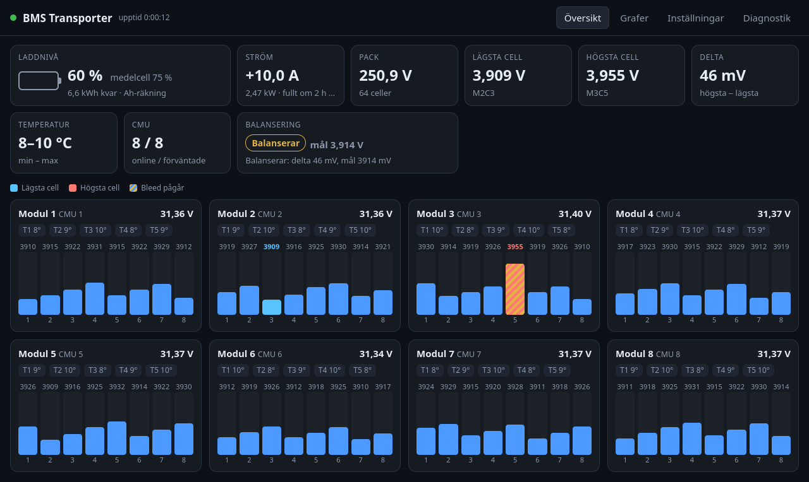

# ESP32 Outlander BMS (v2)

Battery management firmware for an **ESP32-C3** that monitors **8 Mitsubishi Outlander PHEV battery modules (CMUs)** over CAN through an MCP2515, for a 64S lithium pack (~250 V).

**Status:** running in my VW Transporter (powering a big car audio system). Current version: **2.3.3**.



*The built-in web UI (shown here with `tools/mock_server.py`, no ESP32 needed).*

### Features
- Reads all 64 cell voltages, module temperatures and balancing status (4- and 8-cell CMUs)
- Automatic top balancing with safety conditions, plus manual mode
- State of charge, current/power/energy via a WCS1700 hall sensor
- Alarms, 24 h history and 14-day per-cell drift log (finds self-discharging cells)
- Web UI on its own Wi-Fi access point (works without home network), OTA firmware updates
- CAN recording and diagnostics export, ESP-NOW packets for a separate display
- Logic covered by 72 PC-side unit tests (`python tests/run_tests.py`)

### Credits
The CMU CAN protocol is based on public work by others:
- Tom de Bree – [OutlanderPHEVBMS](https://github.com/Tom-evnut/OutlanderPHEVBMS) (protocol and temperature calibration)
- knoxsp – [OutlanderCANManInTheMiddle](https://github.com/knoxsp/OutlanderCANManInTheMiddle) (CAN dumps from real modules)

The firmware itself was written from scratch, with AI assistance.

> ⚠️ This handles a high-voltage battery pack. Use at your own risk.

The documentation below is in Swedish.

---

## Om projektet (svenska)

Firmware som läser cellspänningar, temperaturer och balanseringsstatus från 8 Mitsubishi Outlander PHEV-CMU:er
via CAN (MCP2515), balanserar automatiskt, larmar och visar allt på en webbsida. Design: [`docs/`](docs/).

## Mappar

| Mapp | Innehåll |
|---|---|
| `BMS_v2/` | Firmwaren (Arduino-sketch) |
| `tests/` | PC-tester av logiken (`python tests/run_tests.py`) |
| `tools/` | `build.py` (kompilering), `mock_server.py` (förhandsvisa webbsidan) |

## Bygga

```bash
python tools/build.py
```

Resultat i `release/`:
- `BMS_v2-<version>-usb.bin` – första programmeringen via USB (adress 0x0). Raderar sparade inställningar.
- `BMS_v2-<version>-ota.bin` – uppdatering via webbsidan. Inställningarna behålls.

`python tools/build.py --sim` bygger en variant med 8 simulerade CMU:er för test utan batteri.

Kräver `BMS_v2/secrets.h` (kopiera `secrets.example.h` och fyll i eget WiFi-lösenord och hemnät).

## Programmera ESP:n första gången (USB, från laptopen)

1. Öppna https://espressif.github.io/esptool-js/ i Chrome eller Edge.
2. Anslut ESP32-C3 med USB, tryck **Connect** och välj porten.
   Om den inte hittas: håll **BOOT** intryckt, anslut USB, släpp BOOT.
3. Flash Address `0x0`, välj `BMS_v2-<version>-usb.bin`, tryck **Program**.
4. Tryck **RST** (eller dra ur och sätt i USB).

Alternativ: Arduino IDE med kortet **ESP32C3 Dev Module**, *USB CDC On Boot: Enabled* och
*Partition Scheme: Minimal SPIFFS (1.9MB APP with OTA/190KB SPIFFS)*. Bibliotek: ESPAsyncWebServer 3.9.x,
AsyncTCP 3.4.x och ArduinoJson 7.x.

## Använda

- Anslut till WiFi **BMS-Transporter** (lösenordet står i `secrets.h`) och öppna http://192.168.4.1
- Hemma (om hemnätet är inställt): http://bms.local eller den fasta IP du valt
- Uppdatera firmware: Diagnostik → Firmware-uppdatering → välj `-ota.bin`.
- Glömt lösenordet: håll **BOOT** intryckt i 5 s medan BMS:en är igång. Nätverksinställningarna återställs.

## Strömsensor (WCS1700)

Koppling: VCC → 3,3 V, GND → GND, AO → GPIO3. DO lämnas oansluten.
Dra **en** ledare genom sensorn (inte + och − tillsammans). Vänd sensorn så att urladdning ger sjunkande
spänning på AO, eller kryssa i "Vänd strömriktningen".

1. Inställningar → Ström och laddnivå → kryssa i "Strömsensor ansluten" → Spara.
2. Med laddare och last avstängda: "Nolla ström nu".
3. Starta laddaren och jämför BMS:ens ström med laddarens. Justera "Känslighet" om de skiljer sig.

Laddnivån räknas från lägsta cellen (3,30 V = 0 %, 4,10 V = 100 %) och visas som **andel av energin**
(från v2.3). Spänningskurvan gäller GS Yuasa LEV46 (46 Ah, 2,75–4,10 V) och ligger i `BMS_v2/soc.cpp`
med källor; kWh kvar räknas med samma kurva. Ah-räkningen sker i laddning och räknas om till energi
för visning. Laddningsprocenten syns om man håller muspekaren över procenttalet. Utan sensor: från vilospänningen
("uppskattad"). Med sensor: Ah-räkning som rättas till 100 % när laddaren slutat och mot vilospänningen
efter 30 min vila.

Grafer: fliken Grafer visar 10 min (1 s upplösning) och 1 h/6 h/24 h (1 min, sparas i flash).

## Cellogg och utjämning (v2.2)

- Cellspänningarna jämnas ut med en tidskonstant på ca 4 s (100 ramar vid 25 Hz). Rådata syns i
  Diagnostik → Rå CAN. Min/max-platsen byter cell först när den nya är minst 0,5 mV lägre/högre.
- Celloggen sparar timmedel för alla 64 celler i 14 dygn (`/cells.bin`, 24 kB). Grafen under Grafer
  visar avvikelsen från medianen; de 5 lägsta och 5 högsta är färgade och tabellen visar drift i
  mV/dygn. En cell som tappar mer än ca 3 mV/dygn vid vila självurladdar troligen.
- MCP2515 filtrerar bort 0x6X4, 0x6X5 och alla icke-CMU-ramar (utom under CAN-inspelning). CAN-varningen
  kräver > 50 overflow per 10 s och ligger kvar 30 s.
- Diagnostik → System visar orsaken till senaste omstart (strömpåslag, OTA, brownout, krasch …).

## Kontroll på riktig hårdvara

Skicka resultatet (och filerna från punkt 4) för analys:

1. Programmera via USB enligt ovan.
2. Anslut till `BMS-Transporter` och öppna 192.168.4.1. Fungerar det helt utan hemnätet?
3. Diagnostik: syns alla 8 CMU-id? Hur många ramar/s per CMU vid 200 ms pollintervall? Ändras det om
   pollintervallet sätts till 100 eller 500 ms? Hur många RX-overflow?
4. Tryck **Spela in CAN 10 s**, ladda ner **CSV** och **rapport**.
5. Temperatur: jämför rådata (Diagnostik, sub 1, byte 2–7) med IR-mätning på modulen och ställ in förskjutningen.
6. Hemma: nås bms.local (och den fasta IP:n), och fungerar BMS-Transporter samtidigt?
7. Balansering: läge Manuell, mål strax under högsta cell. Bara celler över målet ska få bleed (randig stapel).
   Läge Av ska släppa alla.
8. OTA: ladda upp en `-ota.bin` via webbsidan.

## Utveckling

```bash
python tests/run_tests.py
```

```bash
python tools/mock_server.py
```

Mock-servern läser sidan direkt ur `BMS_v2/web_ui.h` och simulerar API:t på http://localhost:8080.
