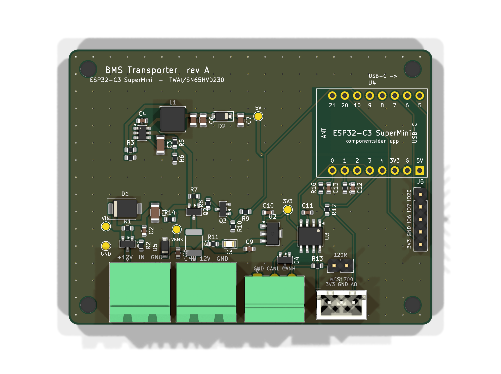

# BMS-kort rev A

Bärkort för ESP32-C3 SuperMini med alltid-på-matning, brytbar CMU-matning, 12 V-mätning och CAN via
C3:ans inbyggda TWAI. Design och beslut: `docs/design-bms-kort.md`.



## Vad kortet gör

- **12 V in (J1)** från det separata AGM-batteriet, med skydd mot omvänd polaritet (Q1) och spikar (D1).
- **5 V till ESP:n, alltid på** (TPS560430X, ca 80 µA i vila). Omvandlaren startar vid 11,5 V och stänger
  av under ca 10,3 V, så kortet kan aldrig djupladda batteriet ens om firmwaren hänger sig.
- **BMS-skena (J2 + CAN + strömsensor)** som ESP:n slår på med GPIO10. Den är av vid start, vid krasch och i
  djupsömn. Grön lysdiod (D3) visar att den är på. Polyfuse 2 A och frihjulsdiod på CMU-utgången.
- **CAN (J3)** med SN65HVD230 på TWAI, ESD-skydd och 120 Ω avslutning med bygel (JP1).
- **12 V-mätning** på GPIO1 (15 V -> 2,5 V) och **WCS1700 (J4)** på GPIO0.
- **Sömnström** ca 0,13 mA från 12 V när SuperMini:s ström-LED är borttagen (ca 0,1 Ah per månad).
- Monteringshålen är opläterade: HV-sidans 12 V är isolerad från karossen och får inte jordas via skruvarna.

| Kontakt | Stift |
|---|---|
| J1 12 V in | +12V, GND |
| J2 CMU 12 V ut | +12V (bryts), GND |
| J3 CAN | GND, CANL, CANH |
| J4 WCS1700 | 3,3 V (bryts), GND, AO |
| J5 expansion (ej monterad) | 3V3, GND, IO6, IO7, IO20 |
| JP1 | bygel på = 120 Ω |

## Filer

| Fil | Innehåll |
|---|---|
| `bms-kort/` | KiCad 10-projekt (schema, kort, egna bibliotek via `../lib`) |
| `fab/bms-kort-gerber.zip` | Gerber och borrfiler |
| `fab/bms-kort-bom.csv`, `fab/bms-kort-cpl.csv` | BOM och placering i JLC:s format |
| `fab/handlodning.csv` | Hålmonterade delar att löda själv |
| `fab/bms-kort-schema.pdf`, `fab/render_*.png` | Schema och bilder |
| `gen/` | Skripten som genererar allt ur `gen/circuit.py` (kretsen) och `gen/layout.py` (placeringen) |

## Generera om

```bash
python hw/gen/library.py
```

```bash
F:/KiCad/bin/python.exe hw/gen/pcb_build.py
```

```bash
F:/KiCad/bin/python.exe hw/gen/route.py
```

```bash
python hw/gen/sch.py
```

```bash
python hw/gen/fab.py
```

`route.py` använder Freerouting 2.x (miljövariabeln `FREEROUTING_JAR` eller `hw/tools/freerouting.jar`, ingår
inte i repot) och slutar med DRC. Allt ska ge 0 fel.

## Beställa hos JLCPCB

1. Ladda upp `fab/bms-kort-gerber.zip`. 2 lager, 1,6 mm, 74 x 56 mm, valfri färg, HASL eller ENIG.
2. Kryssa i **PCB Assembly**, Economic, Top side.
3. Ladda upp `fab/bms-kort-bom.csv` och `fab/bms-kort-cpl.csv`.
4. Kontrollera rotationen i JLC:s förhandsgranskning, särskilt Q1–Q3 och D4 (SOT-23), U2 (SOT-89), U3
   (SOIC-8, punkten vid stift 1), D1, D2, D5 (bandet mot katoden) och D3 (lysdiodens katod mot GND).
5. Sex extended-delar (U1, U2, L1, F1, D1, D4) kostar ca 3 USD var i uppstartsavgift. Resten är basic-delar.

Handlödda delar (`fab/handlodning.csv`): J1, J2 (KF2EDGR-5.08-2P), J3 (15EDGRC-3.5-03P), J4 (B3B-XH-A),
JP1 med bygel och två hylslister 1x8 (C27438) för SuperMini. Beställ pluggarna samtidigt:
2 st KF2EDGK-5.08-2P (C440880) och 1 st 15EDGK-3.5-03P (C5188250).

## Före beställning

1. Mät radavståndet på ditt SuperMini: 15,24 mm. Pinnordningen på kortet (sett ovanifrån, USB-C åt höger):
   nedre raden 0, 1, 2, 3, 4, 3V3, G, 5V och övre raden 21, 20, 10, 9, 8, 7, 6, 5.
2. Kontrollera WCS1700-modulens stiftordning mot J4 (3,3 V, GND, AO).

## Första start

1. Ta bort den röda ström-LED:en på SuperMini (eller låt den sitta och räkna med ca 1–3 mA mer).
2. Utan SuperMini: anslut 12 V via labbagg med strömbegränsning 100 mA. Mät 4,9 V på mätpunkten 5V och
   ca 12 V på VIN. Strömmen ska vara under 0,2 mA.
3. Sänk spänningen: 5 V ska försvinna under ca 10,3 V och komma tillbaka över ca 11,5 V.
4. Sätt i SuperMini och flasha firmware med kortstöd (kommer i nästa version). Kontrollera att den gröna
   lysdioden tänds när firmwaren slår på BMS-skenan och att CMU:erna syns.
